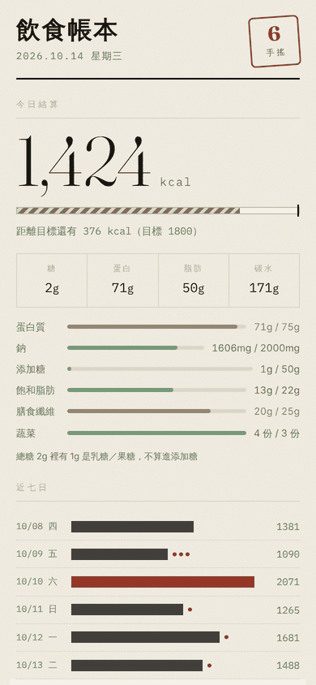
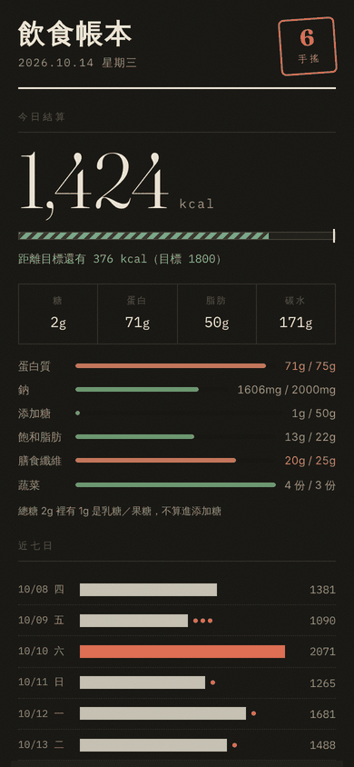

# 飲食帳本（food-log）

[](https://github.com/ssuyu0829/food-log/actions/workflows/ci.yml)

用 Telegram 記錄每天吃的東西，AI 估熱量，手機主畫面上的 PWA 看趨勢。
重點在**看得到自己的飲食趨勢**，特別是手搖飲。

**第一次設定 → 看 [`docs/設定說明.md`](docs/設定說明.md)**

想自己部署一份的話，先知道三件事：

- **一個部署＝一個人。** Bot 只綁一個 Telegram 帳號、PWA 只發一個 token。要給第二個人用就再部署一份。
- `pwa/config.js` 裡的 Supabase 網址**要換成你自己的**，設定說明步驟 7 會講。
- 授權是 MIT，見 [`LICENSE`](LICENSE)。

```
Telegram（拍照／打字）
  └─ webhook ─▶ Supabase Edge Function
                  ├─ 照片 → Gemini vision → 逐項熱量
                  ├─ 手搖 → drinks 熱量表（查不到才上網搜）
                  └─ 存進 Postgres + Storage
                        ├─ report function ──▶ GitHub Pages PWA
                        └─ pg_cron ──▶ 每晚總結 / 每週報告
```

全部落在免費額度：Supabase free、Gemini free tier、Telegram、GitHub Pages。

<p>
  
  
</p>

<sub>截圖是 `deno task mock` 的假資料。</sub>

## 設計與驗證重點

- **讓估算內部一致**：手搖飲不再各自儲存熱量與糖量，而是從同一份配方參數推導；這修掉了同一杯鮮奶茶的兩個欄位隱含奶量相差約 20% 的問題。
- **不把相關性說成校準結果**：體重可幫忙反推能量收支，但無法分開 AI 高估、漏記與個人 TDEE 差異，因此資料不足時只報方向，不輸出看似精確的「高估百分比」。
- **把模型輸出當成不可信輸入**：Gemini 使用結構化 schema，解析後再檢查欄位關係（例如添加糖不能高於總糖）；來源則區分 `official`、`searched` 與 `estimated`。

## 開發方式

我負責定義問題與功能範圍、資料模型、估算口徑及驗證條件；多數實作程式碼由 Claude（AI coding assistant）產生，再由我審查、測試與修正。這個 repo 保留 CI 與測試，讓上述規則可以被重複驗證。

## 目錄

| 路徑 | 是什麼 |
|---|---|
| `supabase/schema.sql` | 資料表。**新裝只要跑這份＋下一份 seed**，可重複執行 |
| `supabase/seed_drinks.sql` | 手搖初始熱量表（**全部是推估值**，見檔頭聲明）。由 `build_drinks.ts` 產生，不要手改 |
| `supabase/alter_2026-09-09_*.sql`<br>`supabase/alter_2026-09-10_*.sql` | **升級用，新裝不要跑**。給 2026-09-10 之前就建好的資料庫補欄位；`schema.sql` 已包含同樣的內容 |
| `supabase/fix_grants.sql` | 救援用。Edge Function 吃到 `42501 permission denied` 時跑 |
| `supabase/cron.sql` | 排程樣板。填了金鑰的版本不要 commit |
| `supabase/functions/_shared/gemini.ts` | **辨識引擎的唯一抽換點** |
| `supabase/functions/_shared/drinks.ts` | 手搖文字解析與熱量公式 |
| `supabase/functions/telegram-webhook/` | Bot 主邏輯 |
| `pwa/` | 前端。部署到 GitHub Pages |
| `dev/mock-server.ts` | 假資料伺服器，改前端時不用連 Supabase |

## 常用指令

需要 [Deno](https://deno.com) 2.x。指令定義在 `deno.json`，`deno.lock` 鎖住相依版本。

```bash
deno task test    # 跑完整測試（與 CI 相同；假的環境變數已經寫在 task 裡，不會連線）
deno task check   # 型別檢查全部 Edge Function
deno task mock    # 本機看前端（假資料）→ http://localhost:8788/?t=demo

# 部署
supabase functions deploy telegram-webhook
git add -A && git commit -m "..." && git push          # PWA 走 GitHub Pages
```

## 在地化

這份是為台灣外食族寫的，下面這些東西寫死在程式裡。不在台灣用的話，改這幾個地方：

| 要改的事 | 在哪裡 |
|---|---|
| 時區、帳本日從幾點開始（現在是凌晨 4 點） | `supabase/functions/_shared/stats.ts` 的 `TZ`、`DAY_START_HOUR`；**`pwa/app.js` 有一份必須同步的複本** |
| 鈉、纖維、蔬菜、添加糖、飽和脂肪的門檻 | `stats.ts` 的 `TARGETS`（附出處） |
| 手搖品牌別名與配方 | `_shared/drinks.ts` 的 `BRAND_ALIASES`、`supabase/build_drinks.ts`（改完重跑產生 `seed_drinks.sql`） |
| 辨識 prompt 裡的「台灣一般外食份量」 | `_shared/gemini.ts` 的 `SYSTEM` |
| 每日／每週推播的時間（pg_cron 是 UTC） | `supabase/cron.sql` |
| Bot 與 PWA 的文案 | `_shared/format.ts`、`pwa/index.html` |

## 費用與限制

- **Gemini 免費層**：Google 可能拿你傳的照片改善模型；速率超過會回 429，等一分鐘再傳。介意前者就升級付費層（用量很小）或換模型，只改 `gemini.ts`。
- **Supabase 免費專案**：長時間沒有任何請求會被暫停，到 dashboard 按一下就恢復；每天記錄就不會發生。資料庫 500 MB、儲存空間 1 GB。
- **照片**：存在 private bucket，沒有自動清理。一張約 100–300 KB，一天三張大約可以存三到四年；滿了到 Storage 刪舊的就好，記錄本身不受影響。
- **GitHub Pages**：免費方案要 public repo。這個 repo 設計成不含任何金鑰，設 public 是安全的；不想公開就改用 Cloudflare Pages 或 Netlify。
- **單人**：一個部署只服務一個 Telegram 帳號。

## 熱量數字的可信度

- **照片辨識**：誤差約 ±25%。價值在趨勢，不是絕對值。
- **手搖**：`drinks` 表裡 `source_type` 欄位就是誠實標籤——
  `official` / `searched`（有來源網址）才是官方數字，`estimated` 是我用
  「基底 + 糖水 × 甜度」推估的。Bot 回覆時會講明是哪一種。
